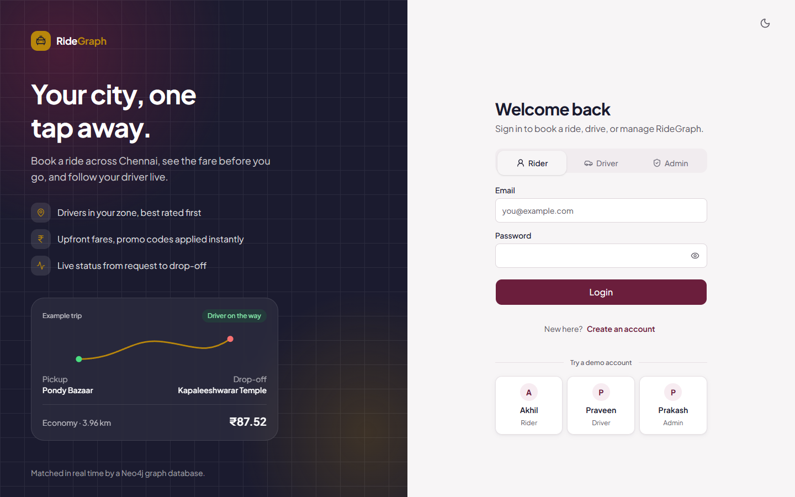
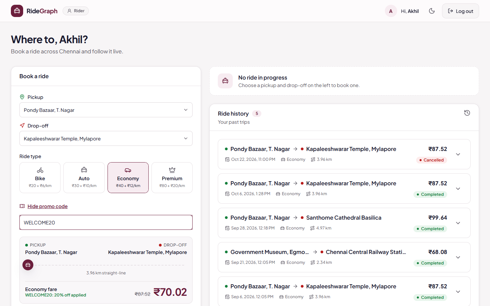
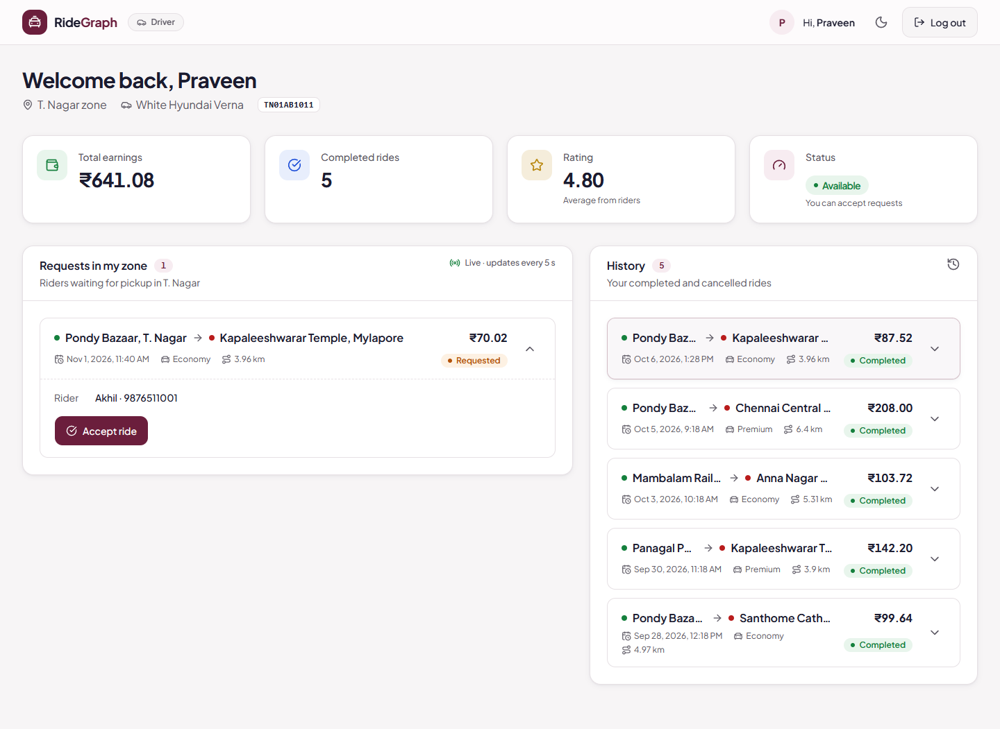
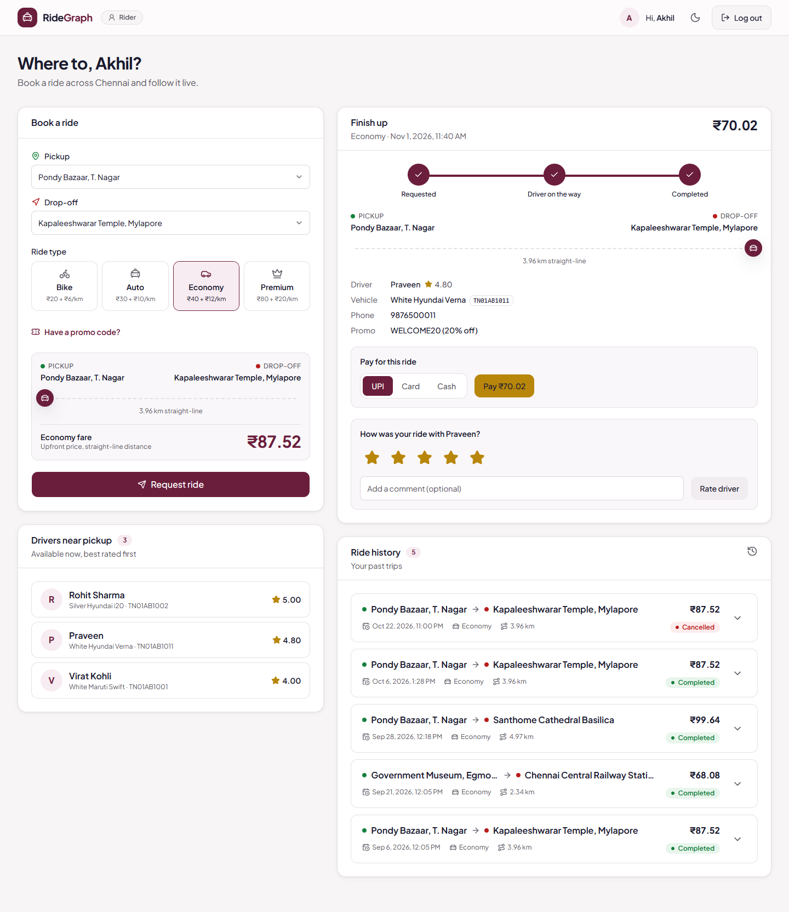
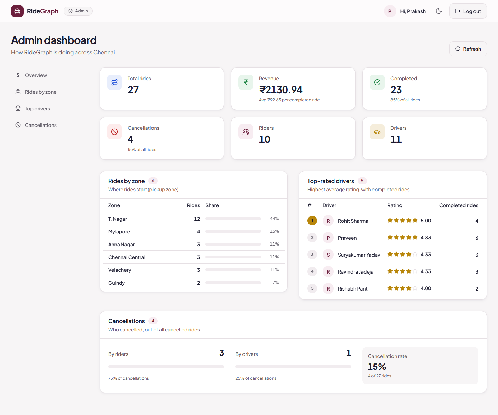
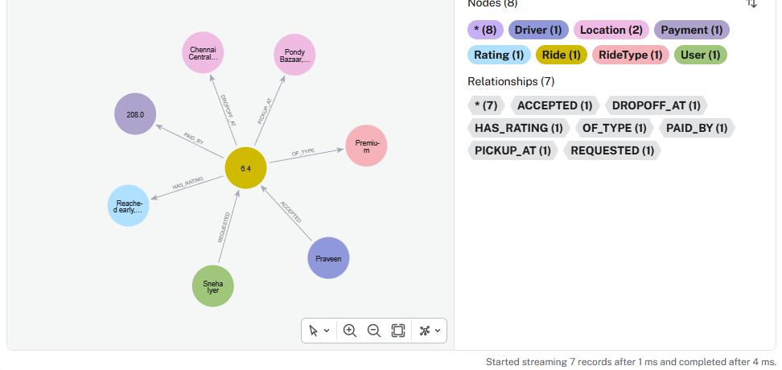

# RideGraph: A Graph-Database Ride-Hailing Platform 

**BACSE202 – Database Management Systems | Fall Semester 2026–2027 | Faculty: Dr. S. Geetha | Slot: D1 + TD1**

**Demo video:** https://drive.google.com/file/d/11rI7FD1uJiBr3lQKsv9nnGIfxgUtdqhg/view

## Team

| Name | Register No. |
|---|---|
| Akhil Gokul | 25BCE5009 |
| Praveen  Sakthi S | 25BCE1605 |
| Prakash  V | 25BCE1769 |

## Problem statement

Ride-hailing apps have to answer questions that are really about connections. Which available drivers are close to this pickup point? Which open requests can this driver see? Which drivers has this rider used before? When the data sits in relational tables, each of these questions needs a chain of joins across users, drivers, vehicles, zones, locations and rides. RideGraph stores the domain as a property graph in Neo4j, so these questions become short graph traversals.

## Abstract

RideGraph is a working ride-hailing web application for Chennai with three roles: rider, driver and admin. A rider picks a pickup point, a dropoff point and a ride type, sees a fare estimate and requests a ride. A driver in the same zone sees the request and accepts it, and later completes it. The rider then pays and rates the trip. An admin dashboard shows revenue, rides per zone, top drivers and cancellations. The data model has 11 node labels and 12 relationship types, derived from an ER model whose relational form was normalized to 3NF. The data is stored in Neo4j and queried in Cypher through a Flask REST API, and the interface is built in React. The API validates every input, uses conditional updates to prevent two drivers accepting the same ride, and stores passwords only as salted hashes. An automated test script checks the complete ride life cycle and the error cases.

## Functional features

1. **Register and log in** as a rider (email) or driver (phone), plus a built-in admin account. Passwords are stored as salted hashes, and a failed login always gives the same generic message.
2. **Fare estimate and ride request.** The distance comes from the haversine formula. Fare = base fare + per-km rate × distance, minus any promo discount (e.g. `WELCOME20`).
3. **Nearby drivers.** Shows the available drivers in the pickup zone, best rated first.
4. **Driver workflow.** A driver sees open requests in their own zone, accepts one (double booking is prevented), then completes it, which creates a pending payment.
5. **Pay and rate.** The rider pays by cash, card or UPI and gives a 1–5 rating once per ride. The driver's average rating is recalculated after each rating.
6. **Cancellation.** The rider or the driver can cancel a requested or accepted ride, with a reason. The driver becomes available again.
7. **History and earnings.** Riders see their ride history, and drivers see their rides and total earnings.
8. **Admin dashboard.** Shows totals, revenue, rides per zone, top drivers and cancellations by role.

## Technology stack

| Layer | Technology |
|---|---|
| Database | Neo4j 5.x (Neo4j Desktop 2.x), Cypher |
| Backend | Python 3.10+, Flask, official `neo4j` Python driver, python-dotenv, Werkzeug (password hashing) |
| Frontend | React 19, Vite, React Router, Tailwind CSS, shadcn/ui components, Motion (Framer Motion) |
| Testing | `tests/test_api.py` (Python standard library only) |

## Repository structure

```
RideGraph/
├── README.md
├── database/
│   ├── schema.cypher        # constraints (primary/unique keys) and indexes
│   ├── sample_data.cypher   # synthetic Chennai demo data
│   └── queries.cypher       # CRUD, traversals, aggregation, subqueries, "views", transactions
├── src/
│   ├── backend/             # Flask API: app.py, db.py, queries.py, seed.py, utils.py
│   └── frontend/            # React source (src/) and pre-built site (dist/)
├── screenshots/             # application and database evidence
├── tests/
│   ├── test_api.py          # automated end-to-end API tests
│   └── TEST_CASES.md        # test cases with expected outcomes
├── report/DBMS_Project_Report.pdf
├── presentation/DBMS_Project_Presentation.pptx
├── docs/                    # ER diagram, architecture diagram, viva notes
├── requirements.txt
├── run_windows.bat          # one-click setup and run (Windows)
└── run_mac.command          # one-click setup and run (macOS)
```

The project uses Neo4j, which was approved by the course faculty, so the database scripts are Cypher (`.cypher`) instead of SQL (`.sql`).

## Setup requirements

* Python 3.10 or newer (on Windows, tick "Add Python to PATH" when installing)
* Neo4j Desktop 2.x with a local Neo4j 5.x instance, listening on `bolt://localhost:7687`
* Node.js is **not** needed to run the app, because the built site is in `src/frontend/dist`. You only need it if you want to edit the frontend.

## How to run

### 1. Create the database
1. In Neo4j Desktop, create a local instance (for example `ridegraph-db`), set its password and click **Start**.
2. Copy `src/backend/.env.example` to `src/backend/.env` and put your password in it:
   ```
   NEO4J_URI=bolt://localhost:7687
   NEO4J_USER=neo4j
   NEO4J_PASSWORD=<your password>
   NEO4J_DATABASE=neo4j
   ```
   `.env` is listed in `.gitignore`, so it is never committed.

### 2. Load the schema and sample data
Use **either** of these:
* **Automatic:** `run_windows.bat` runs `src/backend/seed.py`, which creates the constraints and loads the data. Running it again is safe because it uses `MERGE`. Use `python seed.py --reset` to wipe the data and reload it.
* **Manual:** in Neo4j Browser or the Query tab, run `database/schema.cypher` and then `database/sample_data.cypher`.

### 3. Run the application
* **Windows:** double-click `run_windows.bat`. It creates a virtual environment, installs the packages, seeds the database, starts the server and opens **http://localhost:5000**.
* **macOS:** `bash run_mac.command`. It uses port 5001 if AirPlay is using port 5000.
* **Manual:**
  ```bash
  python -m venv venv
  venv\Scripts\pip install -r requirements.txt      # macOS/Linux: venv/bin/pip
  cd src/backend
  ..\..\venv\Scripts\python seed.py
  ..\..\venv\Scripts\python app.py                   # open http://localhost:5000
  ```

### Demo accounts (synthetic test data)
| Role | Login | Password |
|---|---|---|
| Rider | `akhil@example.com` | `rider123` |
| Driver | `9876500011` (phone, T. Nagar zone) | `driver123` |
| Admin | `prakash` | `admin123` |

All seeded riders use `rider123` and all seeded drivers use `driver123`. These are demo accounts only and are not real credentials.

## Data model

Each ER entity becomes a node label, and each ER relationship (and each relational foreign key) becomes a relationship type.

| Node label | Key | Main properties |
|---|---|---|
| User | user_id | name, email (unique), phone, password_hash |
| Driver | driver_id | name, phone (unique), license_number (unique), rating_avg, status |
| Vehicle | vehicle_id | plate_number, model, color |
| Zone | zone_id | zone_name, city |
| Location | location_id | address, latitude, longitude |
| RideType | ride_type_id | type_name, base_fare, per_km_rate |
| PromoCode | promo_id | code, discount_percent |
| Ride | ride_id | requested_at, status, distance_km, fare_amount |
| Payment | payment_id | amount, method, status |
| Rating | rating_id | score (1–5), comment |
| Cancellation | cancellation_id | reason, cancelled_by |

| Relationship | Cardinality |
|---|---|
| (User)-[:REQUESTED]->(Ride) | 1 : N |
| (Driver)-[:ACCEPTED]->(Ride) | 1 : N |
| (Ride)-[:OF_TYPE]->(RideType) | N : 1 |
| (Ride)-[:PICKUP_AT]->(Location), (Ride)-[:DROPOFF_AT]->(Location) | N : 1 |
| (Ride)-[:APPLIES]->(PromoCode) | N : 1, optional |
| (Ride)-[:PAID_BY]->(Payment) | 1 : 1 |
| (Ride)-[:HAS_RATING]->(Rating) | 1 : 1 |
| (Ride)-[:RESULTED_IN]->(Cancellation) | 1 : 1 |
| (Driver)-[:DRIVES]->(Vehicle) | 1 : 1 |
| (Driver)-[:LOCATED_IN]->(Zone) | N : 1 |
| (Location)-[:IN_ZONE]->(Zone) | N : 1 |

**Sample data** (all synthetic): 6 Chennai zones, 15 locations, 4 ride types (Economy, Premium, Auto, Bike), 3 promo codes, 10 riders, 11 drivers with vehicles, and 24 historical rides (21 completed with payments and ratings, 3 cancelled).

The ER diagram is in `docs/ER_diagram.png`, and the normalization steps to 3NF are in the report.

## Main Cypher queries

All of the application's queries are in `src/backend/queries.py`, and each one is commented. `database/queries.cypher` has runnable versions of them, covering:
* Create, read, update and delete (`CREATE`, `MATCH`, `SET`, `DETACH DELETE`)
* Multi-hop traversals (the graph equivalent of joins), such as finding nearby drivers
* Aggregation: revenue, rides per zone, top drivers
* Subqueries: `EXISTS {}`, `COUNT {}` and `CALL {}`
* A reusable "view" query
* Transactions
* Constraint violations
* Indexes

## Screenshots

| | |
|---|---|
|  Login |  Fare estimate with promo |
|  Driver sees request in zone |  Pay and rate |
|  Admin dashboard |  Ride subgraph in Neo4j |

All screenshots, including the error-handling and test-output ones, are in the `screenshots/` folder.

## Testing

1. Start the server (`run_windows.bat`, or `python app.py` in `src/backend`).
2. In a second terminal, from the project folder, run:
   ```bash
   venv\Scripts\python tests\test_api.py
   ```
   The script goes through register → login → fare estimate → request → accept → complete → pay → rate → cancel → history → admin stats. It also checks the error cases: duplicate email (409), missing fields (400), wrong password (401), a driver outside the zone (403), double accept (409), double payment or rating (409), and an invalid score (400). Afterwards it deletes the test data it created.

**Result (01-11-2026): 73 passed, 0 failed.** All three database scripts (156 statements) also ran without errors. `tests/TEST_CASES.md` lists every test case with its expected and actual outcome.

## Known limitations

* Login is kept simple, with no JWT or session tokens. The API trusts the user and driver ids sent by the browser, and the admin statistics endpoint has no token check.
* Distances are straight-line (haversine) distances, not road distances, and there is no live GPS tracking or map.
* A driver's location is their zone, not live coordinates.
* Payment is simulated, with no payment gateway.
* NOT NULL and type constraints need Neo4j Enterprise, so on Community/Desktop those rules are enforced in the API.

## References

See the report (`report/DBMS_Project_Report.pdf`) for the full IEEE-style reference list. The main ones are the Neo4j Cypher Manual, the Neo4j Python Driver Manual, the Flask documentation and the React documentation.
